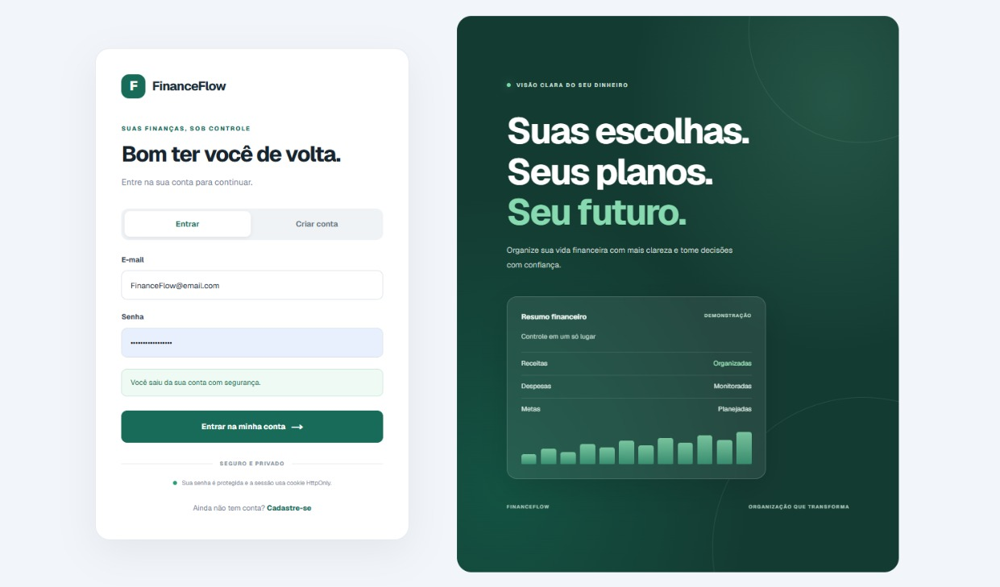

# FinanceFlow

[🇧🇷 Português (Brasil)](README.md) | [🇺🇸 English](README.en.md)

**Aplicação Full Stack para gerenciamento de finanças pessoais.**

O FinanceFlow é uma aplicação web desenvolvida para facilitar a organização das finanças pessoais. Permite que os usuários registrem e gerenciem receitas e despesas, acompanhem o saldo e visualizem um resumo financeiro por meio de uma interface moderna, intuitiva e responsiva.

**Repositório:** [github.com/dev-ley/FinanceFlow](https://github.com/dev-ley/FinanceFlow)

## Prévia da aplicação



## Funcionalidades

- **Autenticação de usuários:** cadastro, login, consulta da sessão autenticada e logout.
- **Sessões seguras:** autenticação baseada em JWT armazenado em cookie `HttpOnly`.
- **Gerenciamento de transações:** criação, consulta, edição e exclusão de receitas e despesas.
- **Dashboard financeiro:** visualização do saldo, total de receitas e total de despesas.
- **Isolamento de dados:** as transações são associadas ao usuário autenticado, com controle de acesso no backend.
- **Validação de dados:** validação dos dados recebidos pela API.
- **Interface responsiva:** adaptação da interface para computadores, tablets e celulares.

## Tecnologias utilizadas

### Frontend

- [Next.js](https://nextjs.org/) — framework React para aplicações web.
- [React](https://react.dev/) — construção da interface.
- [TypeScript](https://www.typescriptlang.org/) — tipagem estática.
- [Tailwind CSS](https://tailwindcss.com/) — estilização da interface.

### Backend

- [NestJS](https://nestjs.com/) — framework para desenvolvimento da API.
- [TypeScript](https://www.typescriptlang.org/) — desenvolvimento tipado.
- [Prisma ORM](https://www.prisma.io/) — acesso e manipulação dos dados.
- [PostgreSQL](https://www.postgresql.org/) — banco de dados relacional.
- [Passport JWT](https://www.passportjs.org/) / [JWT](https://jwt.io/) — autenticação baseada em tokens.
- [bcrypt](https://github.com/kelektiv/node.bcrypt.js) — hash de senhas.

### Infraestrutura e ferramentas

- Docker — execução do ambiente de banco de dados em contêiner.
- Git e GitHub — versionamento e hospedagem do código.
- Jest — execução de testes automatizados.
- ESLint e Oxlint — análise estática e verificação de código.
- API REST — comunicação entre frontend e backend.

## Arquitetura

O FinanceFlow utiliza uma arquitetura Full Stack com separação entre a interface, a API e a persistência dos dados.

```text
FinanceFlow/
├── frontend/                 # Aplicação web
│   ├── app/                  # Páginas e layout
│   │   ├── login/            # Página de login
│   │   ├── register/         # Página de cadastro
│   │   ├── globals.css       # Estilos globais
│   │   ├── layout.tsx        # Layout principal
│   │   └── page.tsx          # Página inicial
│   ├── components/           # Componentes reutilizáveis
│   │   ├── auth/             # Componentes de autenticação
│   │   ├── dashboard/        # Componentes do dashboard
│   │   └── transactions/     # Componentes de transações
│   ├── hooks/                # Hooks de autenticação e dados
│   ├── lib/                  # Utilitários e funções compartilhadas
│   └── styles/               # Tokens de estilo
│
└── backend/                  # API REST
    ├── prisma/               # Schema e configuração do Prisma
    ├── src/
    │   ├── auth/             # Autenticação e sessão
    │   ├── prisma/           # Serviço de acesso ao banco
    │   ├── transactions/     # Regras de negócio das transações
    │   ├── users/            # Gerenciamento de usuários
    │   ├── app.module.ts     # Módulo principal
    │   └── main.ts           # Inicialização da aplicação
    └── test/                 # Testes e configuração de testes
```

*Nota: a estrutura acima resume os diretórios principais; os nomes e arquivos específicos podem variar conforme a versão atual do repositório.*

### Responsabilidades das camadas

**Frontend**

Responsável pela interface, navegação, formulários, apresentação dos dados financeiros e comunicação com a API. Os hooks organizam a lógica de autenticação, dashboard e transações, enquanto os componentes mantêm a interface modular.

**Backend**

Responsável pela API REST, autenticação, validação das requisições, regras de negócio e autorização de acesso aos dados. A separação em módulos facilita a manutenção e a evolução da aplicação.

**Banco de dados**

O PostgreSQL armazena os usuários e suas transações. O Prisma ORM fornece a camada de acesso aos dados e permite definir o modelo relacional da aplicação.

**Comunicação**

O frontend envia requisições HTTP ao backend. As rotas protegidas utilizam a sessão autenticada para identificar o usuário e controlar o acesso às suas transações.

## Segurança

A aplicação implementa mecanismos de segurança importantes para uma aplicação que manipula informações financeiras pessoais:

- **JWT em cookie `HttpOnly`:** impede o acesso direto ao token por JavaScript executado no navegador.
- **Hash de senhas com bcrypt:** as senhas não são armazenadas em texto puro.
- **Rotas protegidas:** endpoints privados exigem autenticação.
- **Controle de propriedade:** as operações sobre transações consideram o usuário autenticado.
- **Validação de entrada:** o backend utiliza validação de dados para rejeitar requisições inválidas ou campos não permitidos.
- **CORS com credenciais:** permite a comunicação autenticada entre o frontend e o backend nas origens configuradas.
- **Configuração por variáveis de ambiente:** segredos e configurações sensíveis devem ser mantidos fora do código-fonte.

> A utilização de cookies `HttpOnly` reduz a exposição do token ao JavaScript, mas não elimina todos os riscos de segurança. Em produção, também é necessário configurar HTTPS, CORS e as opções dos cookies adequadamente, além de avaliar as proteções contra CSRF conforme a estratégia de autenticação adotada.

## Modelo de dados

O modelo principal é composto por dois conceitos:

- **User:** representa o usuário cadastrado na plataforma.
- **Transaction:** representa uma receita ou despesa pertencente a um usuário.

Cada transação possui informações como tipo, descrição, valor, data e associação ao usuário responsável. A relação entre usuários e transações permite consultar e gerenciar os registros respeitando a propriedade dos dados.

## Como executar o projeto

### Pré-requisitos

- Node.js compatível com as versões utilizadas no projeto.
- npm.
- Docker e Docker Compose, caso utilize o ambiente de banco de dados em contêiner.
- PostgreSQL, caso opte por uma instalação local.

### 1. Clonar o repositório

```bash
git clone https://github.com/dev-ley/FinanceFlow.git
cd FinanceFlow
```

### 2. Configurar o backend

```bash
cd backend
npm install
```

Configure as variáveis de ambiente necessárias, incluindo a conexão com o PostgreSQL e o segredo JWT, de acordo com os nomes utilizados no projeto.

Depois, execute as migrações do Prisma conforme a configuração do repositório:

```bash
npx prisma migrate deploy
```

Inicie a API em desenvolvimento:

```bash
npm run start:dev
```

A API utiliza a porta `3000` por padrão, salvo configuração diferente por variável de ambiente.

### 3. Configurar o frontend

Em outro terminal:

```bash
cd frontend
npm install
npm run dev
```

O frontend utiliza a porta `3001` no ambiente de desenvolvimento configurado para este projeto.

**Importante:** confirme a URL da API e a origem CORS nos arquivos de configuração antes de iniciar os serviços. Se necessário, ajuste-as para corresponder às portas utilizadas localmente.

### Variáveis de ambiente

As variáveis exatas dependem da configuração atual do backend e do frontend. Entre as configurações esperadas estão:

- URL de conexão com o PostgreSQL.
- Segredo usado para assinar tokens JWT.
- Porta da API.
- URL ou origem permitida do frontend.
- URL base da API utilizada pelo frontend.

Consulte os arquivos de configuração do projeto para confirmar os nomes exatos das variáveis.

**Nunca publique credenciais, segredos JWT, senhas ou arquivos `.env` com valores sensíveis no repositório.** Se necessário, disponibilize um arquivo `.env.example` contendo apenas nomes de variáveis e valores fictícios.

## Testes e qualidade de código

O backend utiliza Jest para testes automatizados e Oxlint para análise estática.

Executar os testes:

```bash
npm test -- --runInBand
```

Executar os testes com relatório de cobertura:

```bash
npm run test:cov -- --runInBand
```

Verificar o código com lint:

```bash
npm run lint
```

Compilar o backend:

```bash
npm run build
```

Os testes existentes verificam comportamentos básicos do controller e a instanciação do serviço de transações. A cobertura atual é limitada e pode ser ampliada futuramente para abranger os fluxos de autenticação, as operações CRUD e as regras de autorização.

## Objetivos e conhecimentos demonstrados

O FinanceFlow foi desenvolvido para consolidar e demonstrar conhecimentos práticos em desenvolvimento Full Stack, incluindo:

- Desenvolvimento de APIs REST com NestJS.
- Criação de interfaces com Next.js e React.
- Utilização de TypeScript no frontend e no backend.
- Autenticação baseada em JWT e cookies HTTP-only.
- Hash de senhas e validação de dados.
- Modelagem relacional e persistência com PostgreSQL.
- Integração com Prisma ORM.
- Operações CRUD.
- Controle de acesso aos dados por usuário.
- Organização modular do código.
- Testes automatizados e ferramentas de qualidade.
- Configuração de um ambiente de desenvolvimento com Docker.

## Status do projeto

**Estado:** funcionalidades principais implementadas.

O FinanceFlow possui autenticação de usuários, dashboard financeiro e gerenciamento de receitas e despesas. O projeto pode continuar evoluindo com melhorias nos testes automatizados, relatórios financeiros, visualizações adicionais e configurações de produção.

As funcionalidades futuras são possibilidades de evolução, não fazem parte necessariamente da versão atual.

## Autor

**Wesley Rodrigues**  
Desenvolvedor Web Full Stack

- GitHub: [@dev-ley](https://github.com/dev-ley)
- LinkedIn: [wr-dev](https://www.linkedin.com/in/wr-dev/)
- Portfólio: [westack.netlify.app](https://westack.netlify.app)
